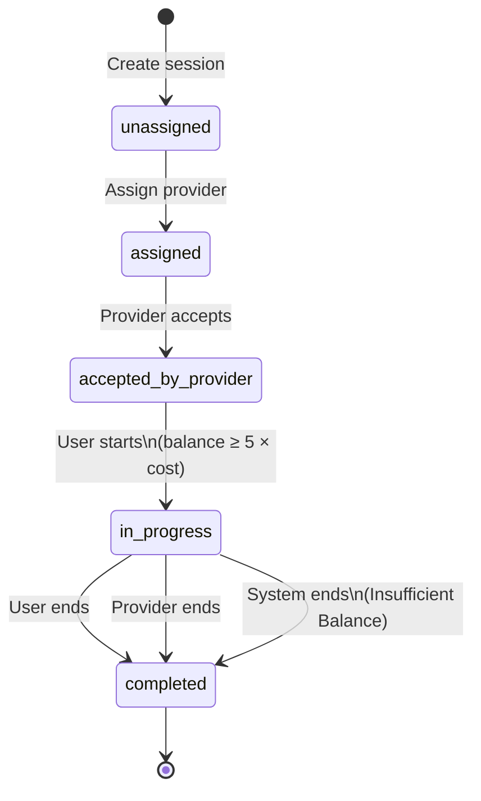
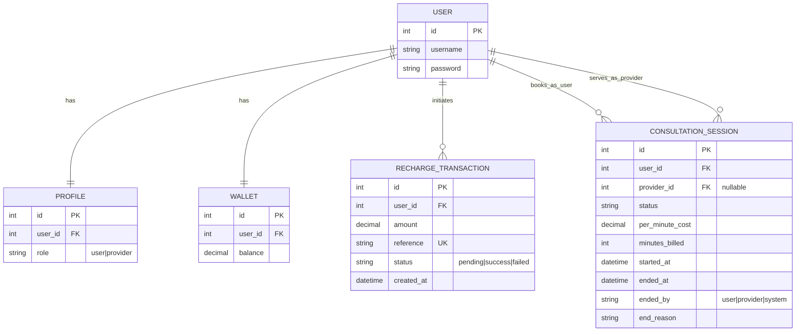

# Diagrams

## 1. Session state machine

**Rules**

- Only listed transitions are allowed; anything else returns **HTTP 400**.
- A user may have at most one `in_progress` session.
- `per_minute_cost` is set at create and used for all billing on that session.
- Billing uses `minutes_billed` so the same target minute is not charged twice.

---

## 2. ER-style overview

**Relationships**

| Link | Cardinality | Notes |
|------|-------------|--------|
| User ↔ Profile | 1:1 | Role; auto-created on user signup (signal) |
| User ↔ Wallet | 1:1 | Prepaid balance |
| User → RechargeTransaction | 1:N | Mock payment attempts; `reference` unique |
| User → Session (as user) | 1:N | Customer / payer |
| User → Session (as provider) | 1:N | Nullable until assigned |
